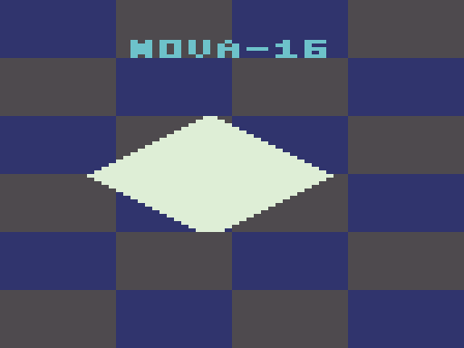

# NOVA-16 — nova16-virtual-computer

[](https://github.com/oyunBAZI/NOVA-16/actions/workflows/ci.yml)

A deterministic fictional 16-bit computer and development toolchain, primarily
written in **Zig 0.17.1**. Real guest assembly runs on its CPU, draws its display,
and responds to input. No external emulator core or host-rendered demo shortcuts.



## Use it

Get a native headless package from [Releases](https://github.com/oyunBAZI/NOVA-16/releases)
and follow [INSTALL.md](INSTALL.md). Packages include emulator, assembler,
debugger and typed compiler, seven V1 ROMs, guest libraries, complete project
sources/tests, manuals and integrity manifests. See Releases for verified versions;
v0.4 acceptance and publication status is tracked in [the ledger](docs/v0.4-ledger.md).

Or install the exact Zig release from [ziglang.org](https://ziglang.org/download/)
and build without third-party dependencies:

```sh
git clone https://github.com/oyunBAZI/NOVA-16.git
cd NOVA-16
zig build
zig build test --test-timeout 2m
zig build fmt
python3 scripts/acceptance.py
zig-out/bin/nova16 run zig-out/demos/boot_splash.n16 --headless --frames 120 --screenshot zig-out/splash.ppm
zig-out/bin/n16dbg zig-out/demos/paint.n16
```

[Native Linux, Windows and macOS acceptance](docs/platforms.md) covers Debug and
ReleaseSafe, actual SDL2 input/renderer output, ROM boot and extracted packages.
Cross-builds for Windows and both macOS architectures use native host asset tools:

```sh
zig build -Dtarget=x86_64-windows -Doptimize=ReleaseSafe
zig build -Dtarget=aarch64-macos -Doptimize=ReleaseSafe
```

`zig build test` executes tests on the build host, even during cross-compilation.
Native CI supplies the corresponding target-OS execution evidence.

## Profile2 development

The `0.5.0-dev` branch implements explicit V2 ROMs, four programmable sound
voices, timer/frame interrupts, EI/DI/IRET, portable snapshots and exact reverse
history. Default assembly and all original V1 formats remain unchanged.

```sh
zig build
zig-out/bin/nova16 run zig-out/demos/nova_sound.n16 --frames 180 --wav nova-sound.wav
zig-out/bin/nova16 run zig-out/demos/interrupt_canvas.n16 --frames 180 --wav canvas.wav --screenshot canvas.ppm
python3 scripts/v2_acceptance.py
```

See [V2 usage](docs/v2-implementation.md) and the [verification ledger](docs/v2-implementation-ledger.md).
This development version is separate from the historical v0.4 release.

## Machine and tools

- Eight 16-bit registers, separate PC/SP, Z/N/C/V; strict 2/4-byte ISA and traps.
- 64 KiB bus, RAM execution, protected ROM, checked stack, palette/input MMIO.
- 128×96 packed 4bpp display, headless PPM and unchanged State JSON schema 1.
- Bounded indexed two-pass assembler: local includes/project roots, multi-error
  rich/JSON v2 diagnostics, safely staged output files, forward constants,
  byte listings, legacy symbols and checksum-bound source maps.
- Debugger: instructions/frames, input injection, break/watchpoints, disassembly,
  non-destructive device inspection, 128-entry trace, optional reverse history,
  validated portable N16S snapshots, source breakpoints/statement stepping,
  symbolic inspection and deterministic restoration.
- Five guest ROMs: splash, bouncing ball, paint, diagnostics and complete
  [Breakout](docs/breakout.md) with title, score/lives, collisions and win/loss/restart.
- Exhaustive encodings/round trips, independent stateful differential tests,
  golden frames, malformed-input tests, guided fuzzing and published source coverage.
- Component benchmarks, native packages, SHA256 manifests and gated release CI.

```sh
zig-out/bin/n16asm examples/paint.asm --out zig-out/paint.n16 --symbols zig-out/paint.sym --debug-symbols zig-out/paint.sym2 --listing zig-out/paint.lst
zig-out/bin/n16dbg zig-out/paint.n16 --symbols zig-out/paint.sym2
```

Inside the debugger: `input 24`, `frame 1`, `devices`, `trace 10`,
`history 8`, `step`, `reverse`, `savesnap state.n16s`, `loadsnap state.n16s`.
Assembler `--diagnostics json` is available for IDE integration.

## Graphical display

Install SDL2 development libraries, then:

```sh
zig build -Dgui=true
zig build gui-test -Dgui=true
zig-out/bin/nova16 run zig-out/demos/paint.n16 --gui --scale 4 --frames 100000 --max-instructions 1000000000
```

macOS: run `python3 scripts/setup_sdl.py` (CMake required), then add
`--search-prefix .sdl-sdk` to both build commands. This uses pinned genuine SDL2.
Windows/vcpkg: pass its `installed/x64-windows` prefix and put its `bin` directory
on PATH. Linux CI uses system SDL2 and Xvfb. [GUI dependency/test details](docs/gui.md).

| Keys | Action |
|---|---|
|Arrows|Move|
|Z / X|A (paint) / B (erase)|
|Enter / Right Shift|Start (clear) / Select|
|Space / R / Escape|Host pause / reset / quit|

The resizable high-DPI window uses nearest integer scaling. A guest frame is
**20,000 retired instructions**, independent of host time. Runners have finite
default limits; long sessions need explicit larger frame/instruction caps.

## Develop your own guest software

Follow the [developer guide](docs/developer-guide.md) to create a multi-file
program, build, inspect, debug by file/line, replay tests and distribute sources.

```sh
zig-out/bin/n16asm examples/projects/breakout/main.asm --out zig-out/game.n16 --debug-symbols zig-out/game.sym2
zig-out/bin/n16dbg zig-out/game.n16 --symbols zig-out/game.sym2
python3 scripts/game_acceptance.py
```

Previous [v0.3 milestone evidence](docs/v0.3-ledger.md) distinguishes local and
native CI gates. The [V2 architecture proposal](docs/v2-architecture.md) and isolated arithmetic
experiment are future design work; the V1 computer remains unchanged.

## Typed applications and reproducible projects

```
python3 scripts/n16.py new /path/my-app --language n16c
python3 scripts/n16.py test /path/my-app
python3 scripts/n16.py debug /path/my-app
python3 scripts/n16.py pack /path/my-app --out /path/my-app.zip
```

Use `--language asm` for assembly. [Language](docs/language.md), [ABI](docs/guest-abi.md),
[guest library](guest/README.md) and [project workflow](docs/projects.md) document
the bounded interfaces. Python3.10+ is needed for project orchestration only.
The actual compiler/core are Zig. Compiler maps support original-source breaks,
statement stepping and `vars`; old assembly symbols/maps remain readable.

[Crates and Pixel Studio](docs/apps/README.md) are entirely guest-native typed
applications, with replayed screenshots/state tests and portable ROM packages.
Run their manifest tests using `python3 scripts/n16.py test examples/projects/crates`
or replace crates with pixel_studio. SDL2 builds can run their installed ROMs with
`--gui`; headless replays need no SDL2. [v0.4 evidence](docs/v0.4-ledger.md).

## Architecture and references

| Inclusive range | Region | Access |
|---|---|---|
|0000–BFFF|48 KiB RAM/stack|RWX|
|C000–D7FF|6 KiB packed framebuffer|RW|
|D800–DFFF|Whitelisted MMIO|Per register|
|E000–FFFF|8 KiB ROM|RX|

This is an original virtual machine, not a PC-compatible OS or cycle-accurate
hardware emulator. Audio, interrupts, filesystems and networking are future work.

[Architecture/state model](docs/architecture.md) · [ISA](docs/isa.md) ·
[Memory/devices](docs/memory-map.md) · [ROM](docs/rom-format.md) ·
[Assembler](docs/assembler.md) · [Debugger](docs/debugger.md) ·
[Snapshots](docs/snapshots.md) · [JSON/replay](docs/state-json.md) ·
[Examples/hashes](docs/examples.md) · [Test vectors](docs/test-vectors.md) ·
[Testing/fuzzing](docs/testing.md) · [Performance](docs/performance.md) ·
[Releases](docs/releasing.md) · [Engineering evidence](docs/elevation-ledger.md) ·
[Future roadmap](docs/future-roadmap.md)

[Contributing/compatibility](CONTRIBUTING.md) · [Security](SECURITY.md) ·
[Changelog](CHANGELOG.md) · [MIT license](LICENSE)
