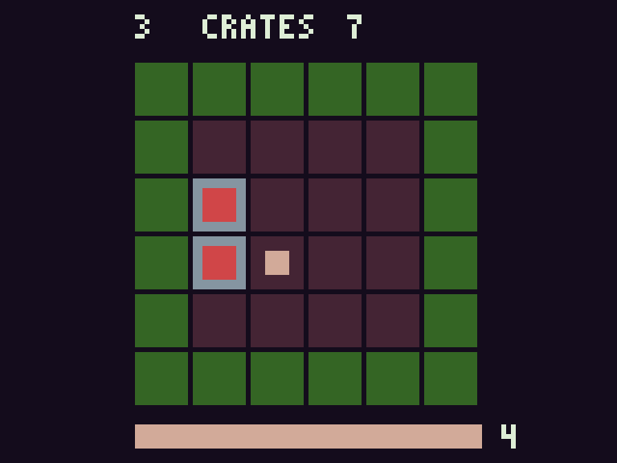
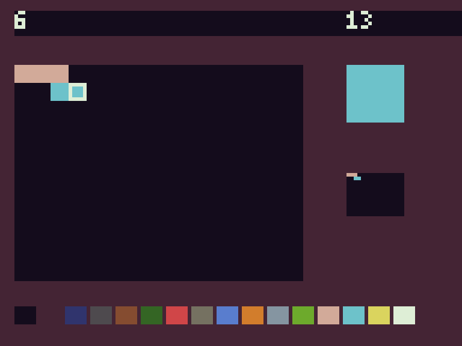

# Developer Platform applications

Both applications are original typed N16 programs. The unchanged V1 CPU runs
every rule, input read and pixel write. They use ABI1 and the guest standard
library; neither has a host-side application engine. `zig build` invokes a native
build-host n16c and installs ROMs, generated assembly, source maps and layouts in
zig-out/demos, even when cross compiling. Payloads: Crates 7,944 bytes;
Pixel Studio 5,010 bytes (the 32-byte N16R envelope is additional).

Build/test/debug/package either project, replacing APP with crates/pixel_studio:

```
python scripts/n16.py test examples/projects/APP
python scripts/n16.py debug examples/projects/APP
python scripts/n16.py run examples/projects/APP -- --gui --frames 36000
python scripts/n16.py pack examples/projects/APP --out dist/APP.zip
```

Create dist first. GUI requires an SDL2-enabled SDK build; headless is the default.
Button mapping is the existing emulator mapping (see controls documentation).
Input schedules use frame/mask pairs; tests use exactly those committed schedules.
`python scripts/application_acceptance.py` additionally checks internal guest RAM
through real debugger snapshots, independent of the expected framebuffer hashes.

## Crates

A six-by-six warehouse puzzle with two crates and two goals. Move with arrows;
push crates onto the blue goal squares. Brown/red blocks are crates, cream is the
player, green is the wall. A crate cannot be pulled or pushed through another.
Both goals filled completes a level. Three layouts change push direction and
player navigation. The checked-in win replay solves all three in seven moves
each. Start begins/restarts the current level; A advances a solved level; B undoes
one successful move, including a deadlock; Select returns to the title/level one.
Pushing a crate into a non-goal corner enters the blocked state. This is corner
detection, not a complete Sokoban solvability solver.

HUD: level / CRATES / move count. Bottom state indicator: 0 title, 1 playing,
2 solved (A to continue), 3 blocked (B or Start), 4 campaign complete. After all
three, Select starts a new campaign. Presses are latched; no uncontrolled key
repeat. Rendering takes multiple guest frames, so input is processed after each
complete redraw. Replay events are spaced sixteen frames apart deliberately.



## Pixel Studio

A sixteen-by-twelve pixel canvas, sixteen-color palette, live miniature preview,
selected ink swatch, edit counter and visible cursor. Arrows move the cursor;
A paints (hold A while moving for a continuous stroke); Select cycles ink,
including color zero for erasing. B undoes the most recent pixel edit once.
Start requests canvas clear (red bottom bar); press Start again to confirm.
Palette changes and cursor movement do not discard artwork. Clear resets undo
and edit count. A tap latches even if released before the guest polls it.

Canvas is 192 little-endian u16 palette indices beginning at RAM0100, row-major.
Save/reload complete artwork through debugger `savesnap`/`loadsnap`. Export a
rendered PPM using `saveframe` or the SDL screenshot control. The app has no
filesystem device and cannot write host files itself. Snapshots preserve ink,
cursor, preview and undo as well as artwork. Clear confirmation persists until
confirmed; there is no cancel key in revision1.



`hashes.json` records actual native PPM SHA256s, including full palette output;
PNGs are nearest-neighbor magnifications of those CPU-generated PPMs. Replays
cover title/completion/collision/undo/restart/deadlock and editor drawing, undo,
and clear. The manifest embeds expected hashes; acceptance never regenerates
goldens. Packages contain the original typed sources and every replay schedule.
