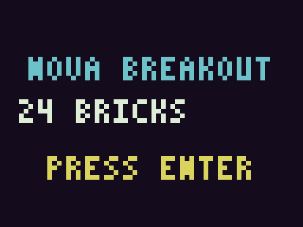
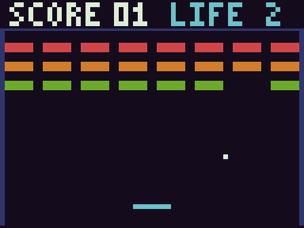
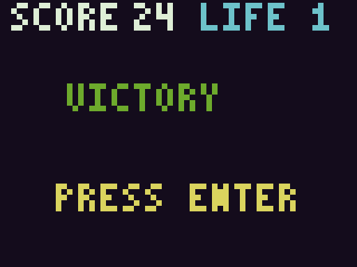
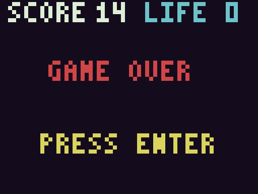

# NOVA BREAKOUT



Build the tools with `zig build` (includes the game), then:

```sh
zig-out/bin/nova16 run zig-out/demos/breakout.n16 --gui --frames 100000 --max-instructions 2000000000
```

Build graphical support first with `zig build -Dgui=true` and the SDL2 dependency
instructions in gui.md. Enter starts/restarts; Left/Right move the cyan paddle.
Bounce the white ball into the 24 red, orange and green bricks. Score counts
bricks destroyed; LIFE shows remaining balls. Three misses end the game.
Clearing all bricks displays VICTORY. Paddle impact position steers left/right.
Space pauses host presentation, R resets to title, Escape quits.



The top row displays score/lives, three brick rows fill the upper playfield,
and the paddle sits near the bottom. Each brick is 12×4 pixels; ball is 2×2,
paddle 16×2. Rendering uses only guest VRAM stores and the default 16-color
palette. Collision, input, scoring, lives and state transitions all run on ISA
V1. No game rule was added to SDL or the emulator. ROM payload is 1,574 bytes.
RAM state at 0100 and the 24 live-brick bytes at 0200 are named in constants.asm.
Updates wait on the documented frame counter. Initial/end screens may span
frames; normal play uses incremental rectangle erasure/redrawing within budget.




Rebuild from modular originals, then debug by file/line or symbol:

```sh
zig-out/bin/n16asm examples/projects/breakout/main.asm --out zig-out/game.n16 --debug-symbols zig-out/game.sym2
zig-out/bin/n16dbg zig-out/game.n16 --symbols zig-out/game.sym2
```

Try `break game.asm:49`, `symbols`, `mem score 2`, `mem bricks 24`, `history 8`,
`step`, `reverse`. Gameplay state is observable guest RAM, not a host control API.

```sh
zig-out/bin/nova16 run zig-out/demos/breakout.n16 --frames 1000 --max-instructions 20000000 --input docs/gameplay/win-input.txt --screenshot zig-out/win.ppm
python3 scripts/game_acceptance.py
```

Recorded schedules cover title/play, a fixed hold-left winning path and a
hold-right losing path. hashes.json records exact P6 framebuffer SHA256s. Native
tests observe real score/board changes, wall/paddle collisions, all 24 destroyed
bricks, three lost lives, restart and two-machine replay from a saved snapshot.
No RAM state is patched to manufacture a win/loss. This first level has one
ball speed and no audio/powerups; more levels are future guest software work.
